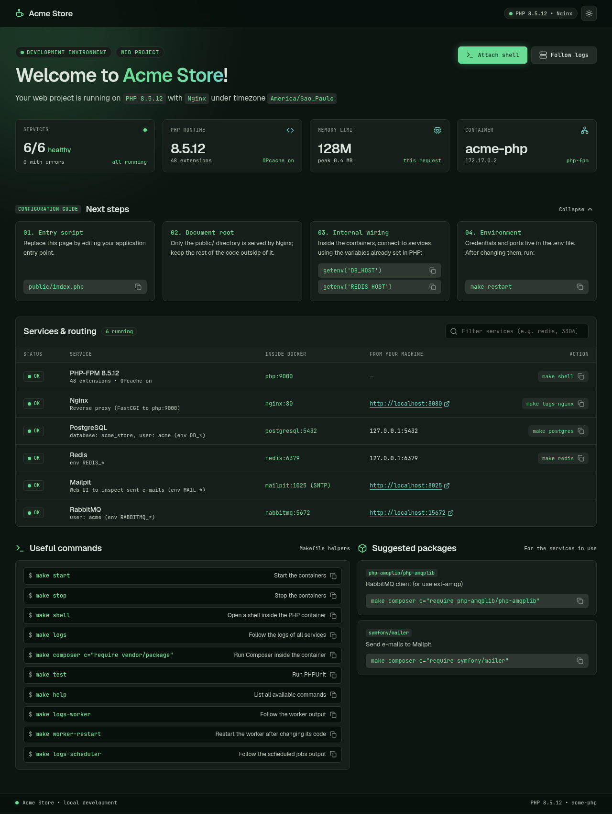
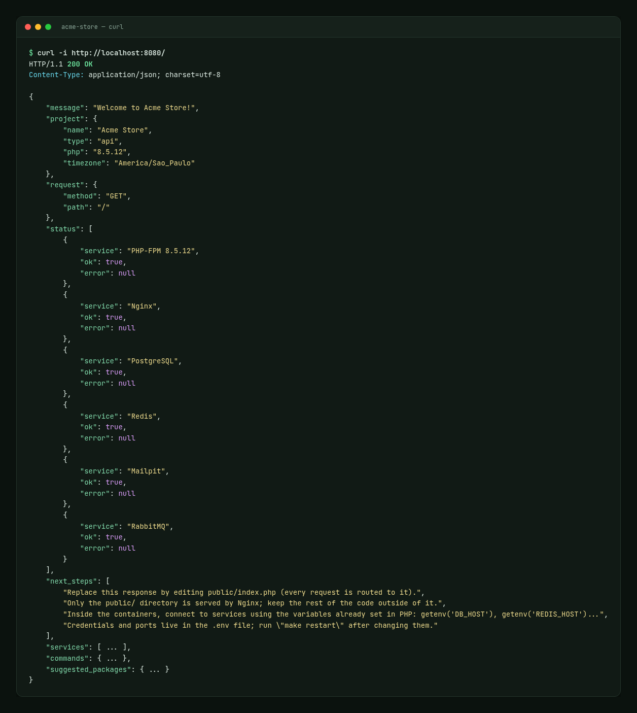
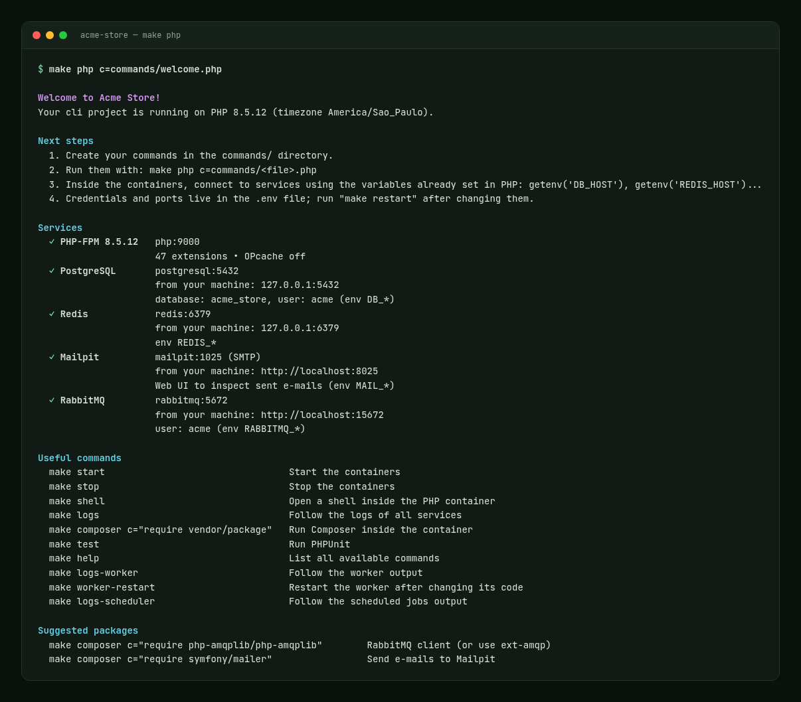

# 🚀 PHP + Docker


Um **ambiente Docker moderno para PHP (8.4 e 8.5)**, flexível e pronto para desenvolvimento local, com suporte a múltiplos bancos, serviços e configurações.

## 🎯 Objetivo

Fornecer um ambiente **rápido e padronizado** para desenvolvimento em PHP, com serviços opcionais como Redis, RabbitMQ, PostgreSQL e mais.
Ideal para uso individual ou em equipe.

## ✨ Principais Características

* ✅ PHP 8.4 ou 8.5 com extensões otimizadas
* ✅ Ambiente **CLI** ou **Web** (com Nginx)
* ✅ Bancos: MySQL 8.4 (LTS) e 8.0, MariaDB, PostgreSQL, MongoDB
* ✅ Serviços extras: Mailpit, RabbitMQ, Redis, Memcached, Meilisearch, OpenSearch, Elasticsearch, RustFS (S3), Kafka, Mercure e Selenium
* ✅ Worker (processo PHP contínuo) e Scheduler (cron) prontos para uso
* ✅ Setup interativo em **bash puro** (sem dependências além de Docker e make) ou não-interativo via flags
* ✅ Credenciais dos serviços já disponíveis no PHP (`getenv('DB_HOST')`, `REDIS_HOST`...)
* ✅ Página de boas-vindas com status real da conexão com cada serviço
* ✅ PHPUnit, PHPStan e PHP-CS-Fixer prontos na estrutura Composer
* ✅ Imagem de produção (`make build-prod`)
* ✅ Portas publicadas apenas em `127.0.0.1`
* ✅ Configuração simplificada via `.env`
* ✅ Makefile com comandos prontos para o dia a dia

## 📋 Requisitos

* Linux com **bash 4.4+**
* **Docker** com o plugin **Compose v2** (`docker compose`)
* **make**

## ⚡ Instalação Rápida

```bash
git clone https://github.com/Diego-Brocanelli/php-docker.git [nome_projeto]
```

```bash
cd [nome_projeto]
```

```bash
make setup
```

> O script guiará a configuração inicial do ambiente.

### Setup não-interativo

Qualquer opção informada pula a pergunta correspondente; `--yes` usa o padrão para o restante:

```bash
make setup ARGS="--name 'Minha API' --type api --db postgresql --services redis,worker --yes"
make setup ARGS="--help"   # lista todas as opções
```

Em `--services`, informe uma lista separada por vírgulas (`mailpit`, `rabbitmq`, `redis`, `memcached`, `meilisearch`, `opensearch`, `elasticsearch`, `rustfs`, `kafka`, `mercure`, `selenium`, `worker`, `scheduler`), ou então `all` ou `none`. As flags `--mailpit`, `--rabbitmq` e `--redis` continuam aceitas.

> ⚠️ OpenSearch e Elasticsearch precisam de ~1 GB de RAM e de `vm.max_map_count` ≥ 262144 (`sudo sysctl -w vm.max_map_count=262144`).

## 🖼️ Exemplos

Ao final do setup é criado um ponto de entrada de boas-vindas de acordo com o tipo de projeto, mostrando o status real da conexão com cada serviço, os próximos passos e os comandos úteis.

> As imagens abaixo foram geradas com dados fictícios (projeto `Acme Store` com PostgreSQL, Redis, Mailpit, RabbitMQ, worker e scheduler).

### Web

`--type web`: página HTML servida pelo Nginx em `public/index.php`, com status dos serviços, filtro, tema claro/escuro e botões para copiar os comandos.



### API

`--type api`: resposta JSON em `public/index.php`, com HTTP `200` quando todos os serviços respondem e `503` quando algum falha (útil como health check).



### CLI

`--type cli`: sem Nginx; o resumo é exibido no terminal por `commands/welcome.php`.



## 🛠️ Comandos básicos

Use o `Makefile` para gerenciar os containers:

```bash
# Configura o ambiente
make setup

# Sobe os containers
make up

# Sobe os containers e acompanha os logs
make logs

# Encerra os containers
make down

# Acessa o banco escolhido
make mysql | make mariadb | make postgres | make mongo | make redis

# Worker e Scheduler
make logs-worker
make logs-scheduler
make worker-restart   # necessário após alterar o código do worker

# Composer e scripts PHP dentro do container
make install
make composer c="require vendor/pacote"
make php c=commands/welcome.php

# Qualidade de código (estrutura Composer)
make test    # PHPUnit
make stan    # PHPStan
make lint    # PHP-CS-Fixer (somente verifica)
make fix     # PHP-CS-Fixer (corrige)
make audit   # vulnerabilidades conhecidas nas dependências
```

> 🔐 As credenciais ficam no `.env` (permissão `600`). A senha padrão dos bancos é `app` (Enter aceita o padrão); no RabbitMQ, Enter gera uma senha aleatória.
>
> 🌐 Por padrão as portas são publicadas apenas em `127.0.0.1`. Para expor na rede, altere `BIND_ADDRESS` no `.env`.
>
> 🐞 O Xdebug é ativado por *trigger* (`XDEBUG_TRIGGER` / extensão do navegador). Defina `XDEBUG_MODE=off` no `.env` para desativá-lo.
>
> 🕒 O timezone (`TZ` no `.env`) é aplicado a todos os containers e ao `date.timezone` do PHP.

## 🔌 Conectando a aplicação aos serviços

O container PHP já recebe as variáveis de cada serviço escolhido — use-as no código em vez de valores fixos:

| Serviço | Variáveis |
|---|---|
| MySQL / MariaDB / PostgreSQL | `DB_CONNECTION`, `DB_HOST`, `DB_PORT`, `DB_DATABASE`, `DB_USERNAME`, `DB_PASSWORD` |
| MongoDB | as de banco acima + `MONGODB_URI` |
| Redis | `REDIS_HOST`, `REDIS_PORT` |
| Mailpit | `MAIL_HOST`, `MAIL_PORT` |
| RabbitMQ | `RABBITMQ_HOST`, `RABBITMQ_PORT`, `RABBITMQ_USER`, `RABBITMQ_PASSWORD` |
| Memcached | `MEMCACHED_HOST`, `MEMCACHED_PORT` |
| Meilisearch | `MEILISEARCH_HOST`, `MEILISEARCH_KEY` |
| OpenSearch | `OPENSEARCH_HOST` |
| Elasticsearch | `ELASTICSEARCH_HOST` |
| RustFS (S3) | `AWS_ENDPOINT`, `AWS_ACCESS_KEY_ID`, `AWS_SECRET_ACCESS_KEY`, `AWS_DEFAULT_REGION`, `AWS_USE_PATH_STYLE_ENDPOINT` |
| Kafka | `KAFKA_BROKERS` |
| Mercure | `MERCURE_URL`, `MERCURE_PUBLIC_URL`, `MERCURE_JWT_SECRET`, `MERCURE_JWT_ISSUER` |
| Selenium | `SELENIUM_URL` |
| Aplicação | `APP_NAME`, `APP_TYPE`, `APP_URL`, `TZ` |

```php
$pdo = new PDO(
    sprintf('%s:host=%s;port=%s;dbname=%s', getenv('DB_CONNECTION'), getenv('DB_HOST'), getenv('DB_PORT'), getenv('DB_DATABASE')),
    getenv('DB_USERNAME'),
    getenv('DB_PASSWORD'),
);
```

## ⏱️ Worker e Scheduler

* **Worker**: executa `commands/worker.php` continuamente (altere `WORKER_COMMAND` no `.env`). Coloque o consumo da sua fila no lugar do `TODO` do loop e rode `make worker-restart`.
* **Scheduler**: executa as tarefas de `docker/templates/services/scheduler/crontab` com o supercronic, dentro do container PHP. O exemplo roda `commands/heartbeat.php` a cada minuto. Depois de editar o crontab, rode `make restart`.

## 💾 Dados e backup

Os dados dos bancos, do Redis, do RabbitMQ e o cache do Composer ficam em **volumes Docker nomeados** (`<projeto>_mariadb_data`, `<projeto>_composer_cache`...):

```bash
docker volume ls                 # lista os volumes
make clean                       # remove containers, MANTÉM os dados
make destroy                     # remove containers E volumes (pede confirmação)
```

## 🏭 Produção

`make build-prod` gera `<projeto>_php:prod` (e `<projeto>_nginx:prod` em projetos web/api) a partir do mesmo Dockerfile, alvo `prod`:

* `php.ini-production`, OPcache sem revalidação de arquivos, `expose_php=Off`;
* sem Xdebug, Node.js ou Deployer;
* código copiado para a imagem e `composer install --no-dev` com autoloader otimizado;
* roda como usuário não-root.

As variáveis de conexão (`DB_HOST`, `REDIS_HOST`...) devem ser fornecidas pelo ambiente de produção. O `.dockerignore` evita que `.env`, `.git`, `vendor/` e `tests/` entrem na imagem.

> 📌 Para mais comandos, veja o arquivo **Makefile**.

## ⚙️ Estrutura de Diretórios

```
.
├── docker/       # Arquivos Docker e configs
├── docs/         # Documentação
├── commands/     # Comandos CLI: welcome.php (cli), worker.php e heartbeat.php (worker/scheduler)
├── public/       # Raiz pública com index.php de boas-vindas (projetos web/api)
├── src/          # Código-fonte (estrutura Composer)
├── tests/        # Testes automatizados (estrutura Composer)
├── .env          # Variáveis de ambiente (gerado)
├── compose.yml   # Serviços Docker (gerado)
├── Makefile      # Atalhos e comandos utilitários
```

## 🔧 Customização

A customização é **modular e simples**: cada serviço possui seu diretório dentro de `docker/templates/services/`.

* **`config/`** → usado para colocar arquivos de configuração específicos.

  * Exemplo: `docker/templates/services/php/config/custom.ini`
  * Pode conter ajustes de extensões, memória, upload, timezone, etc.

* Os dados dos serviços não ficam nesses diretórios: veja **Dados e backup**.

### Exemplos de customização:

* **PHP** → copie `custom.ini.example` para `custom.ini` em `docker/templates/services/php/config/`
* **MySQL/MariaDB** → adicione um `.cnf` em `docker/templates/services/<banco>/config/conf.d/`
* **Scripts de inicialização do banco** → `docker/templates/services/<banco>/config/initdb.d/` (executados apenas na primeira inicialização)
* **Redis** → adicione configs personalizadas em `docker/templates/services/redis/config/`

> 📌 Assim você mantém as configurações isoladas por serviço.

## 💬 Suporte e Feedback

Encontrou um problema? Tem dúvidas ou sugestões de melhoria?
Abra uma **[issue](https://github.com/Diego-Brocanelli/php-docker/issues)** neste repositório para relatar.

> Isso ajuda a centralizar as discussões, manter o histórico das sugestões e melhorar o projeto continuamente.

## 🤝 Contribuição

1. Faça um **fork** do repositório
2. Crie uma branch (`git checkout -b minha-feature`)
3. Faça commit das mudanças
4. Envie um **Pull Request** 🎉

## 📜 Licença

Distribuído sob a licença MIT. Veja [LICENSE](LICENSE).
